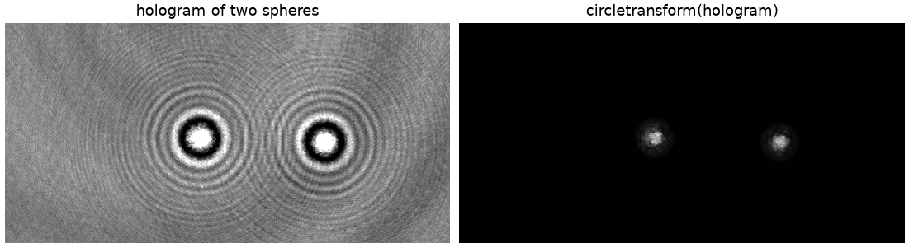
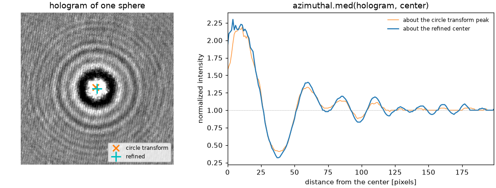

# dgimage: image transformations for holography and microscopy

[](https://pypi.org/project/dgimage/)
[](https://pypi.org/project/dgimage/)
[](LICENSE)
[](https://github.com/davidgrier/dgimage/actions/workflows/test.yml)
[](https://dgimage.readthedocs.io/en/latest/)
[](https://doi.org/10.5281/zenodo.24166147)

**dgimage** is a small library of the image transformations and radial statistics that the
[Grier group](https://github.com/davidgrier) uses across projects.  It needs
only `numpy` and `scipy`: no camera, no GUI and no analysis framework, so that
[QVideo](https://github.com/davidgrier/QVideo),
[pylorenzmie](https://github.com/davidgrier/pylorenzmie) and other programs
can share one implementation of each algorithm.



## Install

```bash
pip install dgimage
pip install dgimage[fast]    # with OpenCV: the circle transform is twice as fast
```

## Use

```python
import numpy as np
from dgimage import circletransform

heat = circletransform(image)      # peaks are the centers of rings
y, x = np.unravel_index(heat.argmax(), heat.shape)
```

The transform of Krishnatreya and Grier locates circularly symmetric features,
such as the rings of the hologram of a sphere, without knowing their radius.
A program that transforms many frames of one shape builds a
`CircleTransform`, which keeps its kernel.  The radial profile of a ring
about its center is

```python
from dgimage import azimuthal

profile = azimuthal.med(image, center=(x, y))      # also avg, std, mad
```



## Contents

| Transformation | What it does |
|----------------|--------------|
| `circletransform` | orientation alignment transform: a map of the centers of rings |
| `azimuthal` | average, standard deviation, median and median absolute deviation of an image as a function of the distance from a center |

More will join them as projects of the group need them, such as the
Crocker-Grier local-maximum finder.

## Documentation

<https://dgimage.readthedocs.io>

## Citing

See `CITATION.cff`.  The orientation alignment transform is described in
B. J. Krishnatreya and D. G. Grier, "Fast feature identification for
holographic tracking: the orientation alignment transform," *Optics Express*
**22**, 12773-12778 (2014).

## License

GPL-3.0-or-later, like QVideo and pylorenzmie.  See [LICENSE](LICENSE).

## Acknowledgements

Work on this project at New York University is supported by the National
Science Foundation of the United States under award number DMR-2428983.
