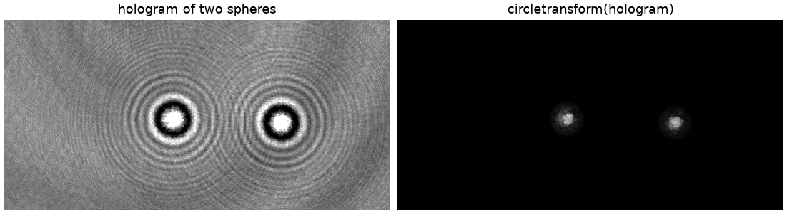
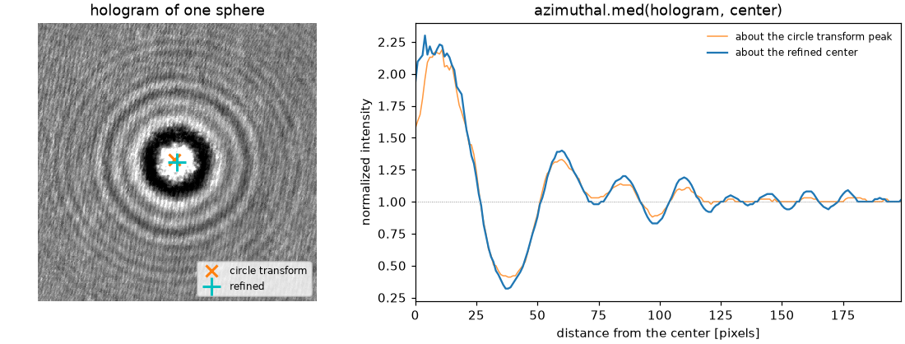

Quickstart
==========

The orientation alignment transform
-----------------------------------

The rings of the hologram of a sphere are circularly symmetric about the
position of the sphere, whatever its size.  The orientation alignment
transform [Krishnatreya2014]_ turns an image into a map whose peaks are the
centers of such rings::

    import numpy as np
    from dgimage import circletransform

    heat = circletransform(image)
    y, x = np.unravel_index(heat.argmax(), heat.shape)

For example, a real hologram of two silica spheres (from
`pylorenzmie <https://github.com/davidgrier/pylorenzmie>`_) becomes two
sharp peaks, one at the center of each set of rings (the map is shown
with a square-root stretch, which makes the peaks easier to see):

         which has one peak at the center of each sphere.

``image`` is a gray image of any real type, ``uint8`` or ``uint16`` counts
included, and the scale of its pixels does not matter.  The result is a
``float`` array of the same shape, scaled so that its peak is 1; a uniform
image gives zeros.  To find several particles, look for the local maxima of
the map, for example with ``scipy.ndimage.maximum_filter`` or
``skimage.feature.peak_local_max``.

Every pixel contributes the direction of its gradient, computed with a
Savitzky-Golay filter of width ``window`` (13 pixels) and order ``polyorder``
(3), the values of the paper.  A wider window smooths noise and blurs the
centers::

    heat = circletransform(image, window=7, polyorder=2)

Speed
-----

The derivatives of the image take half of the time of the transform.  With
`OpenCV <https://pypi.org/project/opencv-python/>`_ installed (``pip install
dgimage[fast]``) they take a few percent, and a frame of 1280 x 1024 is
transformed in about 14 ms instead of 29 ms.  The numbers are the same, to
rounding, with or without it; dgimage uses OpenCV only if it can import it.

Two options trade accuracy for more speed.  Both are off by default, so the
default is always the published algorithm in double precision.  The times are
for a real hologram of two spheres, 1280 x 1024, with OpenCV:

==============================  ========  ==================================
Option                          Time      What it costs
==============================  ========  ==================================
(default)                       14 ms     nothing: the reference
``dtype=np.float32``            8 ms      3e-7 of the peak; same peak
``binning=2``                   6 ms      a smoother map, a coarser grid
``binning=4``                   2 ms      likewise, and a map a quarter size
``float32`` with ``binning=4``  2 ms      both
==============================  ========  ==================================

``dtype=np.float32`` is the safe one: the map differs from the double
precision map by 3e-7 of its peak, far below anything that a detector or a
display can see.  ``binning=n`` averages blocks of *n* by *n* pixels before the
transform and returns the map on the coarser grid, of shape ``(ny // n,
nx // n)``, so a position in it is *n* times smaller than in the image.  The
map is smoother than the full one, and rings finer than the blocks are
averaged away.  In this hologram the full map breaks the blob of one sphere
into fragments scattered over 70 pixels, so its highest pixel is not a stable
position; the binned map is one blob, and the centroid of that blob agrees
with the full map's to about a pixel.  Locate a sphere by the centroid, and
refine the center in the full image before measuring::

    from scipy import ndimage

    heat = circletransform(image, binning=2, dtype=np.float32)
    blobs, count = ndimage.label(heat > 0.25)
    y, x = ndimage.center_of_mass(heat, blobs, range(1, count + 1))[0]
    x, y = 2 * x + 0.5, 2 * y + 0.5             # in the pixels of the image

Many frames
-----------

The Fourier space kernel depends on the shape of the image only.  A program
that transforms a series of frames builds a :class:`~dgimage.CircleTransform`
once and calls it::

    from dgimage import CircleTransform

    transform = CircleTransform()
    for frame in frames:
        heat = transform(frame)

Radial profiles
---------------

The profile of a ring pattern about its center, the average of the pixels at
each distance in whole pixels, comes from the :mod:`~dgimage.azimuthal`
module::

    from dgimage import azimuthal

    profile = azimuthal.avg(image, center=(x, y))
    mean, spread = azimuthal.std(image, center=(x, y))
    median = azimuthal.med(image, center=(x, y))
    median, deviation = azimuthal.mad(image, center=(x, y))

The circle transform finds a sphere to within a few pixels, which is enough to
start but not to measure: a profile about a center that is off by a few pixels
smears the fringes.  The center that makes the hologram most nearly symmetric
is the one that minimizes the azimuthal standard deviation, so a short
refinement with :func:`~dgimage.azimuthal.std` sharpens the profile::

    from scipy import optimize

    def spread(center):
        _, deviation = azimuthal.std(image, tuple(center))
        return np.nansum(deviation[2:150])

    x, y = optimize.minimize(spread, coarse, method='Nelder-Mead').x
    median = azimuthal.med(image, (x, y))

In the figure the transform puts the center at (190, 191); the refinement
moves it to (193.8, 194.6), which agrees with a full fit of the hologram to
Lorenz-Mie theory to 0.1 pixel.  The profile about the refined center has
deeper minima and fringes that stay sharp to large radius, and the median
ignores a speck of dust that an average would feel:

         found by the circle transform and about the refined center.

``center`` is ``(x, y)`` in pixels.  Without it the center is
``(nx / 2, ny / 2)``, which is half a pixel beyond the middle pixel of an
axis of odd length, so give the center when it matters.  The median and its
absolute deviation are robust against outliers such as dust; a radius that
contains no pixels is ``NaN``.  The radial geometry depends only on the shape
and the center and is cached, so a series of frames about one center pays for
it once.

.. [Krishnatreya2014] B. J. Krishnatreya and D. G. Grier, "Fast feature
   identification for holographic tracking: the orientation alignment
   transform," *Optics Express* **22**, 12773-12778 (2014).
